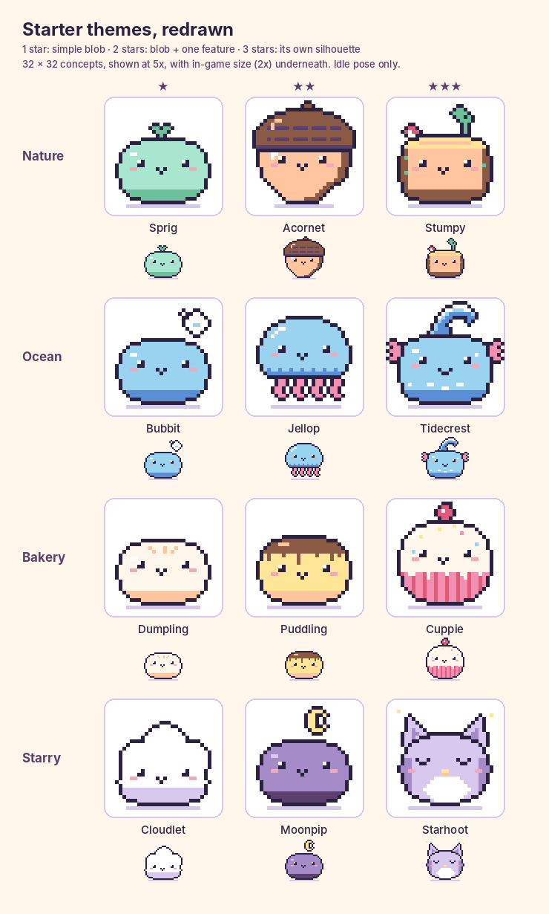

# Art guide: making your own pet characters

This explains how the pet's art is organised, how to draw a character in Aseprite, and how to get it into the game. You never need to change any code to add or replace art.

## How characters work

- Every pet looks the same as an **egg**, a **baby** and a **teen**.
- When the teen grows up, it becomes an adult **character**. Each character has a **theme** (Nature, Ocean, Bakery, Starry, and Cave as a later pack) and a **rarity** of 1 to 3 stars.
- Good care during the baby and teen days raises the chance of a rarer character. The odds are in `src/game/config.ts` under `rarity`. A little one whose parents both grew into 3-star characters uses `rarityStarParents` instead, so it's never 1 star.
- Each pet also gets a **trait** when it's made (Playful, Greedy, Shy, Sleepy or Cheery), and a little one often gets one of its parents'. A trait only changes how often the pet fidgets and which faces it pulls, never its stats. The traits and their numbers are in `src/data/traits.json`. A character can list the only traits its pets can have, e.g. `"traits": ["grumpy", "sleepy"]` in `characters.json`: a pet that grows into it keeps its trait if it's on the list, and otherwise gets one from the list. A trait with `"special": true` in `traits.json` only ever goes to characters that list it, though a little one can inherit it from a parent like any trait (it keeps it as an adult only if its character lists it too). `npm test` checks that every listed trait exists and every special trait is listed by a character. Give such a character its own face set (see below) and its faces look different too.
- A character can have **colour variants** (for example an Amber Pebblit). A variant is just another sheet with a chance of appearing, either drawn or made by swapping palette colours (see [Adding a colour variant](#adding-a-colour-variant)).

Each theme has a common (★), an uncommon (★★) and a rare (★★★) character:

| Theme | ★ | ★★ | ★★★ |
| --- | --- | --- | --- |
| Nature | Sprig | Acornet | Stumpy |
| Ocean | Bubbit | Jellop | Tidecrest |
| Bakery | Dumpling | Puddling | Cuppie |
| Starry | Cloudlet | Moonpip | Starhoot |
| Cave (later pack) | Pebblit (and Amber variant) | Crystalback | Geodon |



The starter characters only have their idle pose properly drawn so far. The other rows are simple placeholder motion made from it: a breathing idle, a small hop for happy and cheerful, a droop for sad, a slow sink for sleep, a sway for sick and a bob for eat (Acornet sways in its idle too). Draw over those rows in their `.aseprite` files. When you redraw a swaying row, take its `headShifts` out of `manifest.json` (or fix the numbers), since they tell the face and hat how far it leans.

**Later packs.** A theme listed under `"laterPacks"` in `characters.json` isn't out yet: pets that already have one of its characters keep it, but no new pet or wanderer grows into one, and the Collection only shows the ones already found. Cave is listed there. Remove it from the list when the pack comes out.

**Shelved art.** Retired characters (Bunbun, Mosscap, Fernwhisk, Glimmer, Starwisp and the old Dumpling, Sprig, Cloudlet and Moonpip) are kept in `art/shelved/`. `npm run export-art` skips that folder.

## Where everything lives

```
art/                               your Aseprite files (the game never loads these)
  _template.aseprite               blank file for a new character
  stages/egg.aseprite, baby, teen
  characters/<theme>/<id>.aseprite
  faces/<set>.aseprite             face sets: one row of faces per expression
  hats/<hat>.aseprite
  badges/tiers.aseprite            achievement tiers: bronze, silver, gold

public/sprites/                    exported PNGs the game loads
  manifest.json                    list of every sheet
  stages/egg.png, baby.png, teen.png
  characters/<theme>/<id>.png
  faces/<set>.png
  hats/<hat>.png
  badges/tiers.png

src/data/characters.json           every character: theme, stars, name, sheet, variants
src/data/hats.json                 every hat: name, price, sheet
src/data/traits.json               every trait (Playful, Greedy...) and its numbers
```

Keep `art/` and `public/sprites/` mirrored: `art/characters/cave/pebblit.aseprite` exports to `public/sprites/characters/cave/pebblit.png`.

## What a sprite sheet looks like

- Every frame is **32 x 32 pixels**.
- Each **row** is one animation, and its frames go **left to right**.
- The rows, top to bottom:

| Row | Animation | When it plays | Frames |
| --- | --- | --- | --- |
| 0 | `idle` | normal, happy | 4 |
| 1 | `sad` | a stat is low, or there's a warning | 4 |
| 2 | `sleep` | lights off | 4 |
| 3 | `sick` | sick | 4 |
| 4 | `eat` | right after you feed it | 4 |
| 5 | `happy` | right after you play, or when it grows up (a big jump) | 4 |
| 6 | `cheerful` | very happy and nothing wrong: calm, smiling, no jump | 4 |

So a full sheet is 128 x 224 pixels. The egg only has an `idle` row. If a sheet is missing an animation (no tag for it, so its row is empty, or the PNG is too short for that row), the game uses `idle` instead, so you can start with just `idle` and add the rest later.

In Aseprite, **the tag's name decides the row**, not the order of the tags: `npm run export-art` puts the `happy` tag on row 5 wherever it is in the timeline. A tag name that isn't an animation (a typo like `hapy`) stops the export with a message, and it lists the animations a sheet has no tag for yet. `npm test` reads the tags in every `.aseprite` file too, and checks each tag has as many frames as its animation.

A sheet can change one animation without repeating the others: list only that one in its manifest entry, e.g. a longer, faster happy jump with `"animations": { "happy": { "row": 5, "frames": 6, "frameMs": 120 } }`. Every other row stays as shared.

## Extra idle moves (idle sets)

A pet can have a few extra idle moves, like a stretch or a look around. While it's idle or cheerful, it plays one of them now and then (every 6 to 12 seconds, picked at random), once, and then goes back to its normal loop. It never does this while sad, sick, asleep or eating.

Moves are shared through an **idle set**, so characters that move the same way are set up once. A set lists its moves and the rows they're drawn on, under `"idleSets"` in `manifest.json`:

```json
"idleSets": {
  "curious": {
    "animations": {
      "idle-look":    { "row": 7, "frames": 4, "frameMs": 260 },
      "idle-stretch": { "row": 8, "frames": 4, "frameMs": 260 }
    }
  }
}
```

A sheet uses a set with `"idleSet": "curious"`, and has those moves drawn on those rows, below the usual seven. A sheet can mix sets with a list, e.g. `"idleSet": ["curious", "owl"]`, to get the shared moves and some of its own. Dumpling and Sprig use `curious` (placeholder moves: a lean to the left and a stretch up tall).

- Move names start with `idle-`, and each move gets a row of its own after row 6.
- Every move has a row of its own, across all the sets (so sets can be mixed), and every sheet using a set draws its moves on those rows. A sheet that should move differently uses a different set, or adds one.
- In Aseprite, add a tag for each move with the move's name (the same as in the set). `npm run export-art` puts it on the move's row; rows of moves a sheet doesn't use stay empty.
- How often moves play is `idleMoveEveryMs` in `src/game/config.ts`.

**Hats follow the moves**, up and down as usual and sideways too: the game sees how far the head moves left or right in each frame of an idle move. Each sheet is measured on its own, so the same move on different bodies still keeps each hat on its own pet's head. If the sideways tracking is off, set it by hand with `headShifts`, in pixels compared to the first idle frame (negative is left), for example `"headShifts": { "idle-look": [-1, -2, -2, -1] }`. Put it on the idle set to fix every sheet using it, or on one sheet for just that one. For up and down, `headOffsets` works on idle moves too. A sheet's own fix wins over its set's, and a set's over its shape's.

## Faces and expressions

The starter characters have their bodies drawn **without a face**. The face is drawn by the game on top, from a shared **face set**, and moves with the head like a hat. So a new expression is drawn once, not once per character and animation.

**A face set** (`art/faces/blob.aseprite`, exported to `public/sprites/faces/blob.png`) has 32×32 frames, see-through except for the eyes, brows, mouth, cheeks and extras like tears or hearts. Each tag is one expression, named as below, with as many frames as you like. `npm run export-art` puts each one on its row by name. A new expression always goes at the **end** of the list (in `src/game/expression-order.ts`), since the game finds each one by its row:

| Row | Tag | Shows when |
| --- | --- | --- |
| 0 | `content` | most of the time (the last frame is a blink) |
| 1 | `happy` | after play, a cuddle or good news |
| 2 | `pouting` | nobody has done anything with it for a few minutes |
| 3 | `sad` | low joy, or feeling poorly |
| 4 | `crying` | very low joy |
| 5 | `surprised` | a visitor or a parcel arrives |
| 6 | `inLove` | after a food it was craving, or playing with a friend |
| 7 | `grumpy` | woken up (Sleepy pets) |
| 8 | `sleepy` | asleep, or low energy |
| 9 | `hungry` | low tummy |
| 10 | `chewing` | while eating |
| 11 | `sick` | sick |

Draw the faces around the pixel (16, 18), which is the bottom of the eyes. The file's guides layer shows Sprig without a face underneath to draw on. `blob` was made from Sprig's test expressions, plus a chewing face (happy eyes, mouth opening and closing) and a sick face (droopy eyes, wobbly mouth, a sweat drop). The rules for which face shows are in `src/game/expressions.ts`, and the numbers in `src/game/config.ts` under `expressions`.

**Each character file** has a third layer, **face**, with the content face on it, so you see the whole pet while you draw the body. `npm run export-art` leaves it out. Draw the body on the **pet** layer without eyes, mouth or cheeks.

**In the manifest**, a body shape's `face` is where the face goes: the pixel in the first idle frame where the bottom of the eyes is. For example `"blob": { "head": {...}, "face": { "x": 16, "y": 18 } }`. Characters with the face lower or higher only need a different `y`.

There are two face sets: **`blob`** for most characters, and **`owl`** (`art/faces/owl.aseprite`) for Starhoot, with big round eyes, a beak and owl versions of every expression.

**A new face set**, for example special faces for 3-star pets:

1. Copy `art/faces/blob.aseprite` to `art/faces/star.aseprite` and redraw the faces. Leave a tag empty to use the blob face for it (only `blob` has to have every expression).
2. Export it, and list it in the manifest under `"faceSets"`: `"star": { "file": "faces/star.png" }`.
3. Give the shape a face point and the set: `"star": { "head": {...}, "face": { "x": 16, "y": 17 }, "faces": "star" }`. A single sheet can also use `"faces": "star"` instead of its shape's set.
4. Take the face off the body in its `.aseprite` file.

A character whose shape has no `face` keeps the face drawn on its body (the stages and Cave for now), and always shows the same expressions as its animations.

## The palette

All art uses one shared 20-colour palette (`src/render/palette.ts`). `docs/palette.gpl` has it as a separate palette file. The starter characters' files have all 20 loaded. Older files (stages, hats, Cave, badges) have the first 16, so load `palette.gpl` in them before using the new ones.

The last four are **outline colours**: `moss` (green), `deep` (blue), `berry` (pink) and `bark` (cream, peach, butter and brown). See the outline rule below.

## Editing an existing character

1. Open its file in `art/`, for example `art/characters/cave/geodon.aseprite`.
2. Paint on the **pet** layer. The **guides** layer shows the feet line (pink), the shadow row (purple) and the centre (blue). It's a reference layer, so it never shows up in the export. The **face** layer is only there to see the face while drawing (see [Faces and expressions](#faces-and-expressions)).
3. Export (see below) over the matching PNG in `public/sprites/`, same name and folder.

That's it. No other file changes, and existing pets pick up the new look.

## Making a new character

1. **Copy the template:** duplicate `art/_template.aseprite` into the theme folder and rename it, for example `art/characters/cave/stalagbun.aseprite`. It already has the size, palette, guides, all 28 frames and the seven animation tags (`idle`, `sad`, `sleep`, `sick`, `eat`, `happy`, `cheerful`), each with the right speed.
2. **Draw** each frame on the **pet** layer with the **Pencil** (B) and **Pixel-perfect** ticked. Never use blur or soft brushes. Keep the feet on the pink line and the pet centred.
3. **Export** the sheet to `public/sprites/characters/cave/stalagbun.png` (see below).
4. **List the sheet** in `public/sprites/manifest.json` under `"sheets"`, with the body shape it's drawn on (see [Body shapes](#body-shapes)):
   ```json
   "stalagbun": { "file": "characters/cave/stalagbun.png", "shape": "wide-loaf" }
   ```
5. **Add the character** to `src/data/characters.json`:
   ```json
   { "id": "stalagbun", "theme": "cave", "stars": 2, "name": "Stalagbun", "sheet": "stalagbun" }
   ```

A new **theme** is one more line under `"themes"` in `characters.json`, then characters can use it. Characters of the same rarity share that rarity's chance equally, whatever their theme.

## Adding a colour variant

There are two ways. A **recolour** is the quickest, and a **drawn variant** gives you full control.

### A recolour (no drawing)

If the variant is the same drawing with some palette colours swapped, list it in `manifest.json` with the sheet it's made `from` and the swaps, using palette names. It has no PNG of its own. The game repaints it when it loads, every animation row included, and it uses the original's shape and idle moves:

```json
"dumpling-matcha": { "from": "dumpling", "recolour": { "cream": "mint", "peach": "leaf" } }
```

To try swaps before writing anything, use the **Recolour** tab on the [art preview page](#the-art-preview-page): pick a replacement for each colour, watch it on every animation, then copy the two JSON lines it makes.

All the swaps happen at once, and each one changes that colour **everywhere** on the sheet. If the face or a highlight uses a colour you're swapping, draw that bit in a different palette colour on the original. **Check it before you add it.** `npm run export-art` (or `npm run export-art -- --previews`, which doesn't need Aseprite) writes two files per recolour to `art/previews/`:

- `dumpling-matcha-x4.png`: the original and the recolour side by side, 4 times bigger, every animation row.
- `dumpling-matcha.png`: the recolour at its real size. If it's nearly right, open it in Aseprite, fix it up, and save it as a drawn variant instead (below).

When it looks good, add the variant to `characters.json` as in step 3 below, with `"sheet": "dumpling-matcha"`.

### A drawn variant

1. Save a copy of the character's file, for example `art/characters/cave/geodon-frost.aseprite`, and recolour it (Edit → Replace Color helps).
2. Export it to `public/sprites/characters/cave/geodon-frost.png` and add it to `manifest.json` with the same `shape` as the character.
3. In `characters.json`, give the character a `variants` list. `chance` is the percent of these characters that get the variant:
   ```json
   { "id": "geodon", "theme": "cave", "stars": 3, "name": "Geodon", "sheet": "geodon",
     "variants": [{ "id": "frost", "name": "Frost", "sheet": "geodon-frost", "chance": 20 }] }
   ```

## Hats

Any hat fits any character, so you draw each hat only once (in a few sizes), and never per character.

**How it works:** every pet sheet in `manifest.json` names a body `shape`, and the shape says where hats sit. In every other frame the game finds how far the top of the head has moved (by looking at the picture) and moves the hat with it, so the hat hops, squashes and sleeps along with the pet.

**If a hat doesn't follow an animation properly**, you can tell the game exactly how far the head moves in each frame of that animation, in pixels compared to the first idle frame (negative is up). Add it to the sheet in `manifest.json`, for example `"headOffsets": { "happy": [1, -4, -5, -3] }`. If every character of a shape needs the same fix, put it on the shape instead. A sheet's own fix wins over its shape's. Idle moves also follow the head sideways (see [Extra idle moves](#extra-idle-moves-idle-sets)).

### Body shapes

Characters drawn on the same body (same size, same top where a hat rests) share a **shape**. Hats are set up once per shape, so a new character on an existing body needs no hat setup at all. The shapes are listed under `"shapes"` in `manifest.json`:

```json
"shapes": {
  "loaf":      { "head": { "x": 16, "y": 15, "width": 14 } },
  "wide-loaf": { "head": { "x": 16, "y": 15, "width": 14 } },
  "owl":       { "head": { "x": 16, "y": 11, "width": 10 } }
}
```

| Shape | Characters |
| --- | --- |
| `baby` | baby |
| `tall` | teen |
| `blob` | Sprig, Bubbit, Dumpling, Moonpip |
| `acorn` | Acornet (hat sits on the acorn cap) |
| `stump` | Stumpy |
| `dome` | Jellop |
| `crest` | Tidecrest |
| `flan` | Puddling |
| `cupcake` | Cuppie (hat sits on the frosting) |
| `cloud` | Cloudlet (hat sits on the top puff) |
| `owl` | Starhoot (between the ears) |
| `loaf` | Pebblit (and Amber) |
| `wide-loaf` | Crystalback |
| `big` | Geodon |

A shape's `head` is the pixel in the first `idle` frame where the bottom middle of a hat should sit, and how wide a hat may be there. To find it, open a sheet of that shape and look at the first idle frame:

- `x`: the column in the middle of the head.
- `y`: the row just below the top of the head, where the hat rests. If hats sit a little too high or low, change `y` by 1.
- `width`: how many pixels wide a hat can be without looking wrong. On a flat or round head that's about the width of the head's top. **If the head has ears, horns or spikes at the sides with a dip in the middle**, put `y` in the dip and use the gap between the ears as `width`, so hats sit between them instead of covering them. On a **dome**, put `y` on the top and use roughly the width of the upper curve.

The game then uses, for every hat, the widest size that fits `width` (or the smallest size, if none fit). A new hat fits every shape without any extra setup.

**Uneven tops.** Hats are always level, so on a lopsided head pick the spot where a level hat looks best (often a little towards the higher side) and nudge from there. A truly tilted hat would need its own drawing.

**A new body** is a new shape: add it under `"shapes"` and point the sheet at it. A one-off character is simply a shape of one.

**If one hat looks wrong on one shape** (a crown slipping between bunny ears, a party hat poking through spikes), nudge just that hat on that shape with `"hats"`, keyed by the hat's sheet name. `x` moves it right, `y` moves it down (negative is up), and `width` picks that hat's size with a different width:

```json
"wide-loaf": {
  "head": { "x": 16, "y": 15, "width": 14 },
  "hats": { "hat-tiny-crown": { "y": -1 }, "hat-party": { "width": 10 } }
}
```

Every other hat and shape stays as it was.

### Drawing a hat

1. Copy any file in `art/hats/`, for example `beanie.aseprite`. It's 16 x 16 with two frames: tag `small` (about 8 pixels wide) and tag `large` (about 12 pixels wide).
2. Draw the hat with its bottom edge on the last row and centred around column 8. Give it the dark outline.
3. Export with **Sheet type: Horizontal Strip** (small on the left, large on the right), to `public/sprites/hats/<name>.png`, so the PNG is 32 x 16.

**More sizes:** a hat can have as many sizes as you like, as frames going from smallest on the left to largest on the right. For example, add a third frame with an extra-wide version for big pets (the PNG is then 48 x 16). The game measures how wide each drawing is, so there's nothing else to set. If a size needs more than 16 pixels, make every frame of that hat wider (for example 24 x 16) and set `frameWidth` to match in step 4.
4. Add it to `manifest.json`:
   ```json
   "hat-scarf": { "file": "hats/scarf.png", "frameWidth": 16, "frameHeight": 16, "animations": {} }
   ```
5. Add it to `src/data/hats.json` with a name and a price:
   ```json
   { "id": "scarf", "name": "Snug Scarf", "price": 90, "sheet": "hat-scarf" }
   ```

It then shows up in the Shop. Glasses could work the same way later with an `eyes` point.

## Achievement badges

The Collection shows each achievement's tier as a small picture. They all live in `art/badges/tiers.aseprite`: 16 x 16, three frames tagged `bronze`, `silver` and `gold`. Its palette has the shared colours plus the four shades of each metal (highlight, light, mid, dark). The game shows each frame at twice its size.

To change them, draw over the frames, then export with **Sheet type: Horizontal Strip** (bronze, silver, gold from left to right) to `public/sprites/badges/tiers.png`, so the PNG is 48 x 16. No other file changes.

## Exporting a sheet from Aseprite

**All at once:** run `npm run export-art`. It exports every file in `art/` to the matching PNG in `public/sprites/` with the settings below (each tag on its animation's row, found by name; hats and badges as one strip; no guides or face layer). It finds Aseprite in the usual install folders. If yours is elsewhere, set `ASEPRITE` to its path. Add words to export only some files, e.g. `npm run export-art -- pebblit hats`. It warns when a sheet changes size, which usually means a tag or frame went missing.

**One by hand:** File → Export Sprite Sheet (Ctrl+E):

- **Layout** tab: Sheet type **By Rows**.
- **Sprite** tab: Layers **Visible layers**, and tick **Split Tags**, so each tag gets its own row. Hide the **face** layer first. By hand, the rows follow the order of the tags, so keep them in the order of the table above (`npm run export-art` doesn't mind).
- **Borders** tab: all padding and spacing at **0**.
- **Output** tab: tick **Output File** and pick the PNG in `public/sprites/`. Untick JSON Data (the game uses `manifest.json`).
- Click Export.

## Consistency rules (especially for AI-generated art)

- **Only palette colours.** Use Sprite → Color Mode → Indexed with the palette loaded to snap stray colours.
- **No anti-aliasing or blur.** Hard edges, pixel to pixel.
- **A dark outline in the pet's own colour**, so its face stands out. Each stretch of the outer edge takes the dark colour of the part it touches: `moss` next to mint or leaf, `deep` next to sky or ocean, `berry` next to pink, blush or rose, `bark` next to cream, peach, butter or cocoa, and `plum` next to white, lavender or lilac. Lines **inside** the pet (seams, folds) and the **face** stay `ink`, so the face is the darkest thing on the pet. Moonpip keeps an ink outline for now, because its plum shading would melt into a plum edge. Hats and the stages still use ink.
- **Same silhouette across frames.** Only small changes between frames (a hop, a blink).
- **Feet on row 28**, with a 1-pixel shadow on row 29. **Centred** horizontally.
- **Keep the top row empty** in every frame, even at the top of a jump. If the head (or its spikes, antenna...) runs off the top, hats can't follow it.
- **Original designs only.** Don't copy existing game characters.

## The art preview page

Run `npm run dev` and open `/art.html` (for example `http://localhost:5173/art.html`). It's a page for drawing, not part of the game, and `npm run build` leaves it out. It draws every sheet the way the game does, and shows the matching part of this guide next to each tool.

- **Pick a pet** on the left: the stages, every character by theme and rarity, and their variants.
- **Guide lines** at the top: the feet line, the shadow row, the centre, the top row (red when something is drawn on it), the hat point and the face point, and a pixel grid.
- **Animations:** play any row or idle move, pause, step frame by frame, and slow it down.
- **Faces:** every expression on the chosen pet. Click one to keep it on.
- **Hats:** try each hat, and see which size it picks and why.
- **Lineup:** every character side by side with the same animation, face and hat.
- **Tweak:** move a shape's hat point, face point or one hat's nudge and see it on every pet of that shape, then copy the JSON into `manifest.json`.
- **Recolour:** swap any of a pet's colours for other palette colours and see it live, with hints for the matching outline colour. Start from scratch or from an existing variant, then copy the `manifest.json` and `characters.json` lines. Your swaps stay through a reload.
- **Checks:** palette colours only, no soft edges, sheet size, an empty top row, feet on row 28 and centred, for one sheet or all of them. `npm test` runs the same checks on every sheet and face set too.
- **Traits:** what each trait changes, and a mood to try out which face it pulls.
- **Try a PNG:** drop an exported sheet on the page. Named like an existing sheet (`sprig.png`, `beanie.png`, `blob.png`), it replaces that one on the page only. Any other name is shown on the selected pet's body.

After exporting, click **Reload art** to see the new PNGs.

## Getting your art into the game

- **On the GitHub website:** open the repository, go to the right folder, choose Add file → Upload files, and commit. Edit `manifest.json` and `characters.json` there with the pencil icon. Upload the `.aseprite` file to `art/` too, so it's kept safe.
- **Ask Claude:** attach your PNG (or `.aseprite`) in the project thread and say its theme and rarity. Claude adds it.

To look at it closely, use the [art preview page](#the-art-preview-page). To try it in the game, run `npm run dev` and use **Settings → Testing tools**: set the Care Score (10, 60 or 90), then **Grow up now** until it's an adult. Start over to roll a new pet. **+100 gold** helps for trying hats from the Shop.

## Regenerating the placeholders

`npm run sprites` makes any placeholder PNG or `.aseprite` file that is **missing**. It never overwrites a file that exists, so your own art is safe. `npm run sprites -- --force` replaces everything with placeholders again. It needs Node.js 22.18 or newer.
